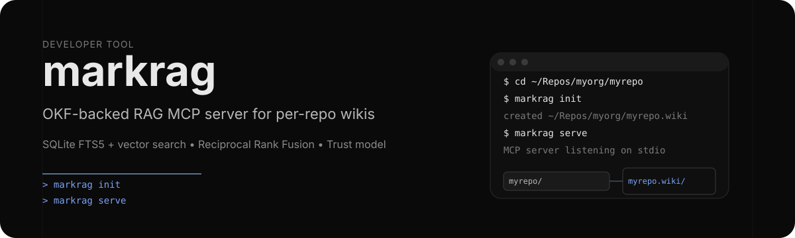

# markrag

<p align="center">
  
</p>

> OKF-backed RAG MCP server for per-repo wikis.

**markrag** serves a curated knowledge wiki as an MCP server so AI coding agents can retrieve trustworthy, per-repository information. The wiki follows the [Open Knowledge Format (OKF) v0.2](https://github.com/GoogleCloudPlatform/knowledge-catalog/blob/main/okf/SPEC.md) specification.

[](LICENSE)

## What it is

markrag makes repository knowledge usable by AI agents without external services.

- **OKF v0.2 compliant** — bundle structure, frontmatter, and metadata
- **Hybrid search** — SQLite FTS5 + vector embeddings with Reciprocal Rank Fusion
- **Trust model** — unverified / machine-confirmed / human-reviewed with staleness tracking

Local-first by default: CPU embeddings via fastembed, no API keys required.

## Quick start

```bash
# install
uv tool install markrag

# create wiki next to your repo
cd ~/Repos/myorg/myrepo
markrag init

# start MCP server
markrag serve
```

The `init` command creates a sibling `myrepo.wiki` directory with `index.md`, `log.md` and seed documents from your README and repo structure. The wiki is a plain git repo you can publish to GitHub Wiki or keep in a reviewable PR.

Environment variables:

| Variable | Description | Default |
|----------|-------------|---------|
| `MARKRAG_REPO` | Path to repository | current directory |
| `MARKRAG_WIKI_REMOTE` | Git remote for wiki | — |
| `MARKRAG_INDEX_DIR` | Search index location | `~/.markrag` |
| `MARKRAG_EMBEDDINGS` | `off` to disable embeddings | enabled |
| `MARKRAG_EMBEDDING_PROVIDER` | `fastembed` or `openai` | `fastembed` |

<p align="center">
  
</p>

## Base usage

```bash
markrag --help
markrag init --repo /path/to/repo
markrag serve --repo /path/to/repo
markrag search "database connection" --type Technology --format json
markrag read technologies/database --section Configuration
markrag index
markrag status
```

MCP configuration is passed via `MARKRAG_REPO` in your client settings. See the wiki for per-client examples.

## Wiki structure

```
~/Repos/<org>/<repo>/
  README.md
  src/
  ...

~/Repos/<org>/<repo>.wiki/
  index.md           # bundle navigation, regenerated
  home.md            # GitHub Wiki homepage, yours to write
  log.md             # append-only change history
  technologies/
    index.md         # section navigation, regenerated
    log.md           # section change history
  processes/
    index.md
    log.md
```

## Who owns which file

markrag draws a hard line between machine-curated navigation and human content:

| File | Owner | Rule |
|------|-------|------|
| `index.md` (root and every directory) | markrag | Regenerated from the concept frontmatter on every write |
| `log.md` (root and every directory) | markrag | Appended to on every write, never rewritten |
| `home.md`, `_Sidebar.md`, `_Footer.md`, `_Header.md` | you | Never written by markrag, in any directory |
| any other `*.md` | you | Written only through `okf_write`, never touched by a rebuild |

The reserved names are reserved at every level of the hierarchy and the
comparison is case-insensitive, so `Index` cannot be used to overwrite
`index.md` on a case-insensitive filesystem.

So a write never leaves the navigation behind: the concept changes, the indexes
are regenerated, and the change is recorded in the log of the wiki root and of
every directory the concept sits in.

`init` follows the same rule. A wiki that already holds documents is never
seeded - markrag does not add concepts to a wiki someone else wrote - but its
`index.md` and `log.md` files are still refreshed, because those are
machine-curated wherever they live. `home.md` is left exactly as it is.

## Trust model

Every document surfaces a trust line so agents can see reliability:

```
[Trust: unverified] Generated by markrag/0.1.0 at 2026-07-09T14:30:00Z.
```

- **unverified** — no `verified` field
- **machine-confirmed** — agent/process verifiers only
- **human-reviewed** — at least one human verifier

All generated content is stamped `generated.by`, `generated.at`, and `status: draft`. Promotion to stable requires a human reviewer to set `status: stable` and add a `verified` entry. markrag never fabricates verification.

## Limits

- The search index lives outside the wiki and can be deleted; it rebuilds on next search.
- Embedding models are downloaded on first use.
- Regenerating the indexes replaces the navigation of every directory. Keep
  hand-written navigation in `home.md` or in a concept of its own.

## Contributing

1. Fork the repository
2. Create a feature branch
3. Make your changes
4. Run tests: `uv run pytest`
5. Submit a pull request

## License

Distributed under [GPL-3.0](LICENSE).

## References

- [Open Knowledge Format (OKF) v0.2](https://github.com/GoogleCloudPlatform/knowledge-catalog/blob/main/okf/SPEC.md)
- [Model Context Protocol (MCP)](https://github.com/modelcontextprotocol/python-sdk)
- [fastembed](https://github.com/qdrant/fastembed)
